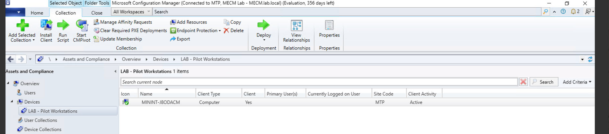
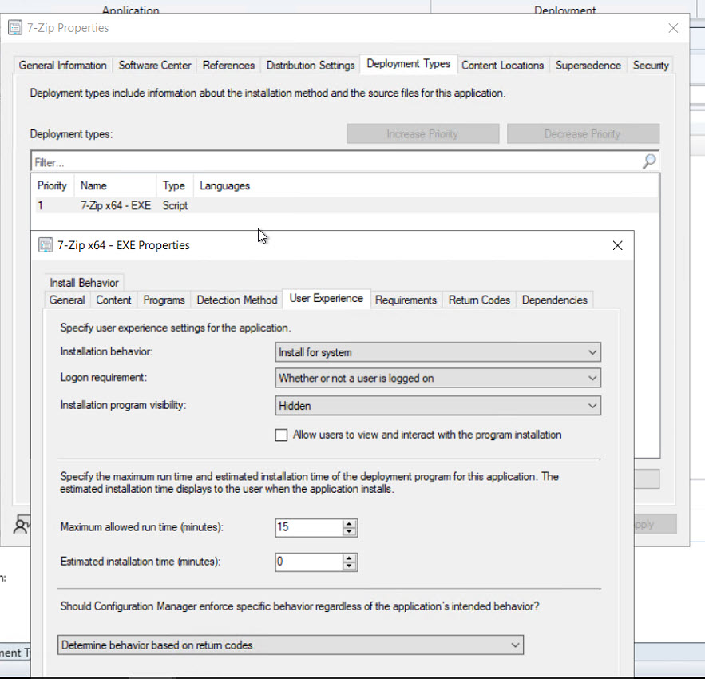
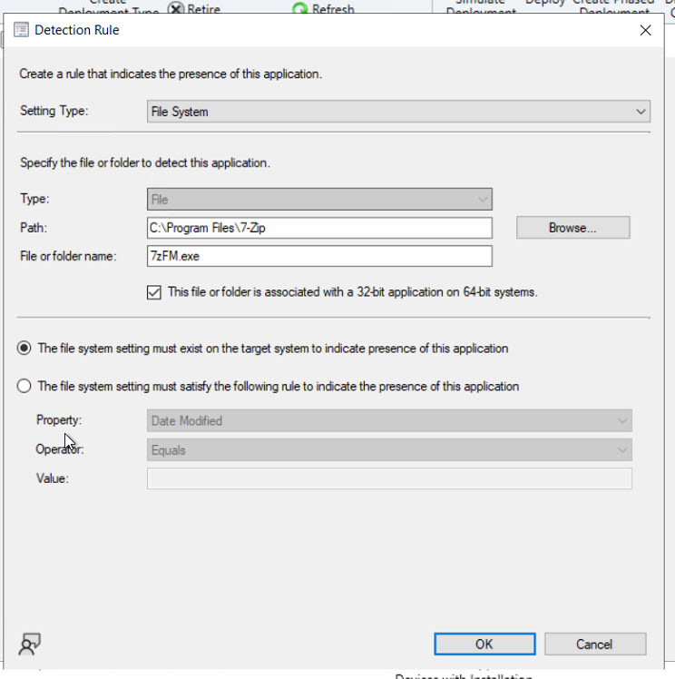
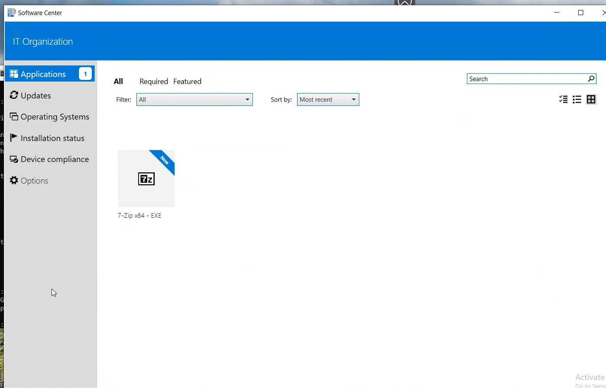

# Déploiement d'une application EXE

## Objectif

Valider un cycle complet de déploiement applicatif MECM en utilisant un installateur .exe, plutôt qu'un MSI automatiquement interprété par Configuration Manager.

Application utilisée :

    7-Zip x64 - EXE

## Collection pilote

Une collection dédiée a été créée :

    LAB - Pilot Workstations

Le poste MININT-J8ODACM est ajouté comme membre direct.

Cette séparation permet de tester un déploiement sur une cible contrôlée avant une éventuelle généralisation.

### Validation de la collection pilote

## Deployment Type

Type :

    Script Installer

Commande d'installation :

    7z2604-x64.exe /S

Contexte :

    Install for system

La détection est basée sur la présence de l'installation 7-Zip sous Program Files.

### Configuration du Deployment Type

### Méthode de détection

## Distribution et déploiement

Le contenu a été distribué sur le Distribution Point MECM.lab.local.

L'application a ensuite été déployée vers :

    LAB - Pilot Workstations

Après récupération de la stratégie, l'application est apparue dans Software Center.

### Distribution du contenu

## Validation dans Software Center

L'application a été installée depuis Software Center et son état est passé à :

    Installed

Le bouton Uninstall est également disponible, ce qui confirme que le Deployment Type est reconnu comme installé.

### Preuves Software Center

## AppDiscovery.log

Avant l'installation :

    Performing detection of app deployment type 7-Zip x64 - EXE
    Application not discovered.
    Did not detect app deployment type 7-Zip x64 - EXE

Le client détermine donc correctement que l'application doit être installée.

## AppEnforce.log

Au lancement :

    Starting Install enforcement for App DT "7-Zip x64 - EXE"
    ContentPath - C:\WINDOWS\ccmcache\1
    Execution Context - System

La commande est préparée depuis le cache client :

    Prepared command line:
    "C:\WINDOWS\ccmcache\1\7z2604-x64.exe" /S

Le processus termine correctement :

    Process 7880 terminated with exitcode: 0
    Matched exit code 0 to a Success entry in exit codes table.

MECM exécute ensuite une nouvelle détection :

    +++ Discovered application
    ++++++ App enforcement completed (1 seconds)

## Chaîne validée

    Application MECM
          ↓
    Deployment Type EXE
          ↓
    Distribution Point
          ↓
    Collection pilote
          ↓
    Policy client
          ↓
    Software Center
          ↓
    ccmcache
          ↓
    Exécution silencieuse en contexte SYSTEM
          ↓
    Exit code 0
          ↓
    Detection Method
          ↓
    Installed

## Logs utilisés

- AppDiscovery.log — état de détection de l'application ;
- AppEnforce.log — commande exécutée, contexte, code retour et détection après installation ;
- CAS.log — résolution du contenu ;
- ContentTransferManager.log — transfert du contenu ;
- ccm.log — Client Push côté serveur.
