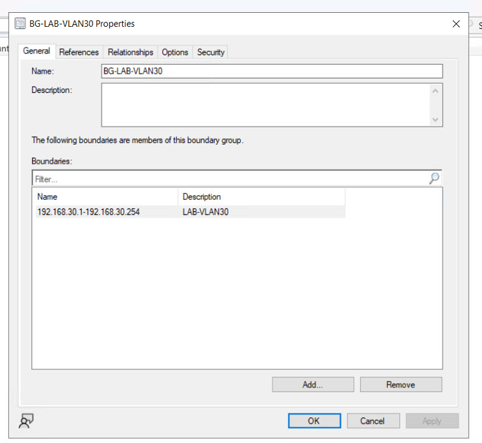

# Onboarding du client Windows 10

## Découverte Active Directory

**Active Directory System Discovery** a été activé dans MECM.

Le poste :

    MININT-J8ODACM

est apparu dans Assets and Compliance > Devices avec :

    Client = No

Cette étape valide la découverte de la ressource, mais pas encore l'installation de l'agent Configuration Manager.

## Boundary et Boundary Group

Boundary :

    LAB-VLAN30
    Type: IP address range
    192.168.30.1 - 192.168.30.254

Boundary Group :

    BG-LAB-VLAN30

Configuration :

- site assignment : MTP ;
- site system : MECM.lab.local.

### Validation du Boundary Group

## Client Push Installation

Le client a été déployé avec **Client Push Installation**.

### Incident 1 — ADMIN$ inaccessible

Depuis le serveur MECM :

    TCP 135 : True
    TCP 445 : False
    \\MININT-J8ODACM\ADMIN$ : False

RPC fonctionnait, mais SMB était bloqué.

### Cause

Les règles Windows Firewall nécessaires au Client Push n'étaient pas ouvertes sur le poste.

Les groupes de règles nécessaires ont été activés pour :

- File and Printer Sharing ;
- Windows Management Instrumentation (WMI).

Après correction :

- TCP 445 répond ;
- ADMIN$ est accessible.

### Incident 2 — credentials Client Push

Le push échouait ensuite dans ccm.log :

    Attempting to connect to administrative share '\\MININT-J8ODACM.lab.local\admin$'
    using account 'LAB\Administrator'

    NetUseAdd failed: 1326

MECM tentait ensuite le compte machine, qui retournait :

    NetUseAdd failed: 5
    ERROR: Failed to connect ... using account 'Machine Account'

### Correction

Le compte LAB\Administrator a été supprimé puis ajouté de nouveau dans les paramètres Client Push avec le mot de passe actuel.

Le log a ensuite confirmé :

    NetUseAdd succeeded for LAB\Administrator!
    Connected to administrative share on machine MININT-J8ODACM.lab.local
    NetUseAdd succeeded for IPC$!
    Copying client files to \\MININT-J8ODACM.lab.local\admin$\ccmsetup.
    Copying file ...\ccmsetup.exe
    Submitted request successfully

## Validation finale

Dans la console MECM :

    MININT-J8ODACM
    Client    : Yes
    Site Code : MTP

Le poste est alors géré par le site et peut recevoir des stratégies, applications et actions clientes.

### Validation visuelle du client

## Points techniques validés

- distinction entre découverte d'une ressource et installation du client ;
- dépendance du Client Push à SMB / ADMIN$ ;
- rôle de RPC ;
- impact des règles Windows Firewall ;
- comptes Client Push ;
- lecture de ccm.log ;
- validation du site assignment.
