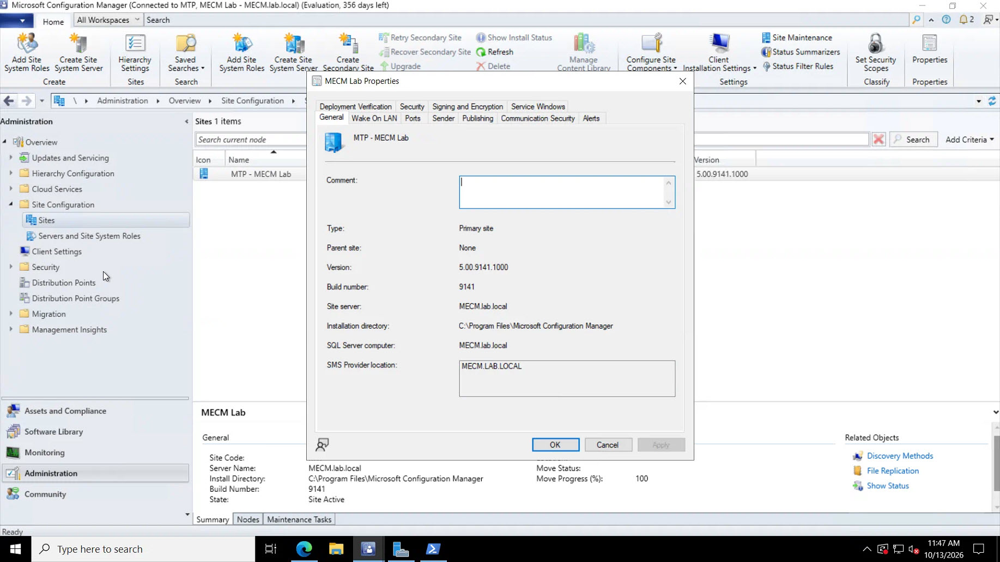
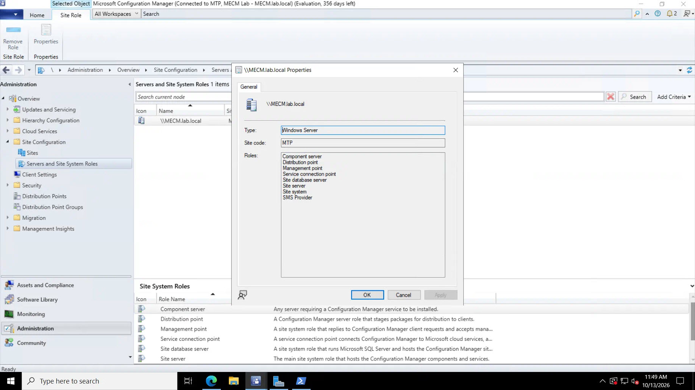
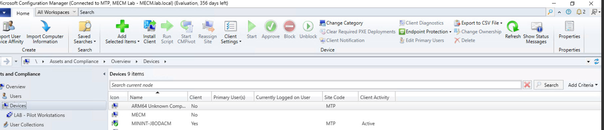
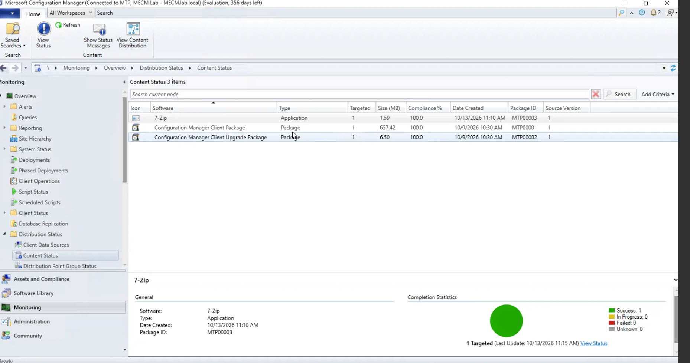
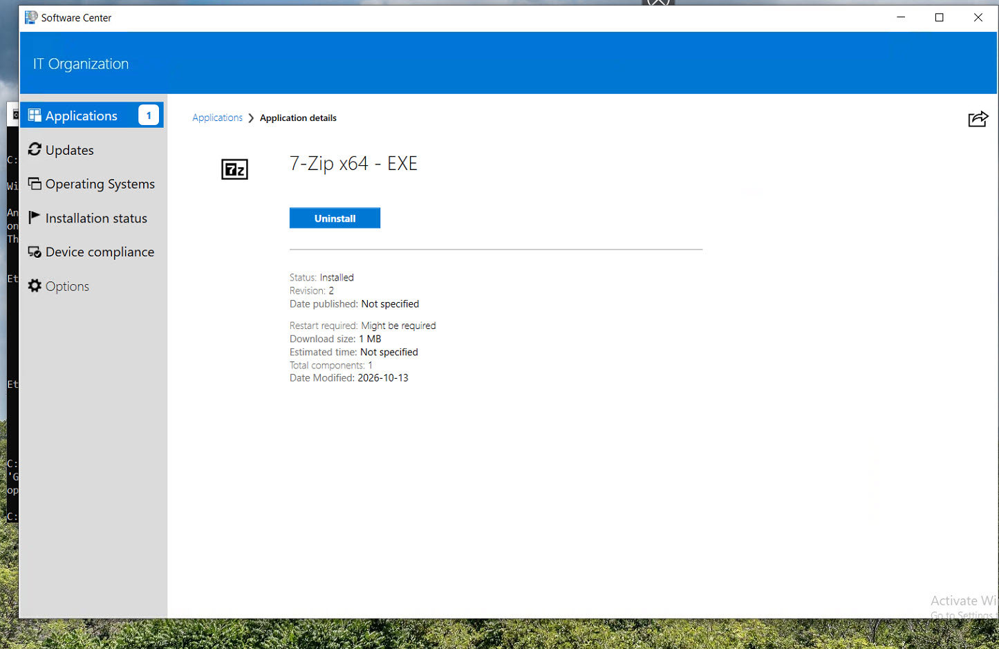

# Projet 02 — Microsoft Configuration Manager (MECM)

## Objectif

Construire un site Microsoft Configuration Manager fonctionnel dans le laboratoire, intégrer Active Directory, gérer un poste Windows 10 et valider un déploiement applicatif complet via Software Center.

Le projet documente également plusieurs incidents réellement rencontrés pendant la mise en place et leur résolution à partir des logs MECM, de tests réseau et de validations SQL.

## Environnement

- MECM.lab.local — Windows Server 2022 Datacenter Evaluation ;
- Microsoft Configuration Manager 2509 Evaluation ;
- site code MTP ;
- SQL Server 2022, instance par défaut ;
- base de site CM_MTP ;
- Win19.lab.local — contrôleur de domaine / DNS du domaine lab.local ;
- MININT-J8ODACM — poste Windows 10 géré par MECM ;
- VLAN30 : 192.168.30.0/24.

Architecture détaillée : [ARCHITECTURE.md](ARCHITECTURE.md)

## Installation et remise en état du site

Le site a été installé en architecture **standalone Primary Site**, avec SQL Server, SMS Provider, Management Point et Distribution Point sur le serveur MECM.lab.local.

La préparation du serveur comprenait notamment :

- SQL Server 2022 ;
- Windows ADK et WinPE ;
- prérequis IIS / BITS / .NET nécessaires ;
- conteneur Active Directory System Management préparé ;
- délégation de contrôle au compte ordinateur LAB\MECM$ ;
- ports SQL 1433 et Service Broker 4022.

Pendant le setup, un premier blocage sur le composant OLE DB a été résolu en installant le driver Microsoft OLE DB 19. La version validée sur le serveur est 19.3.5.0.

Après le Core Setup, le site restait toutefois incomplet : SMS_SITE_COMPONENT_MANAGER fonctionnait, mais SMS_EXECUTIVE n'était pas créé et sitecomp.log répétait :

    Unknown SQL Error!
    Failed to connect to the SQL Server, connection type: SMS ACCESS.
    Failed to read site information from database, retry in 5 seconds ...

Le réseau SQL, la base CM_MTP, TCP 1433 et la connexion OLE DB ont été validés indépendamment. Le problème a finalement été isolé sur **Microsoft ODBC Driver 18.7.1.1**.

Après rollback vers **ODBC Driver 18.6.2.1** et redémarrage :

- SMS_EXECUTIVE est apparu et a démarré ;
- SMS_SITE_COMPONENT_MANAGER est resté opérationnel ;
- les composants du site ont repris leur installation ;
- les erreurs SMS ACCESS ont disparu.

Documentation : [INSTALLATION-AND-RECOVERY.md](INSTALLATION-AND-RECOVERY.md)

## Découverte Active Directory et affectation réseau

**Active Directory System Discovery** a été activé afin d'importer les ordinateurs du domaine dans MECM.

Le poste MININT-J8ODACM est apparu dans Assets and Compliance > Devices avec Client = No.

Un boundary a ensuite été créé pour le VLAN du lab :

    LAB-VLAN30
    192.168.30.1 - 192.168.30.254

Il est associé au boundary group :

    BG-LAB-VLAN30

avec :

- site assignment : MTP ;
- site system : MECM.lab.local.

## Installation du client MECM

Le client a été installé sur MININT-J8ODACM avec **Client Push Installation**.

Deux problèmes distincts ont été diagnostiqués :

1. TCP 135 répondait mais TCP 445 était bloqué par Windows Firewall, ce qui empêchait l'accès à ADMIN$ ;
2. après correction du firewall, ccm.log retournait NetUseAdd failed: 1326 pour le compte Client Push.

Après correction des règles firewall et réenregistrement du compte LAB\Administrator avec le bon mot de passe, ccm.log a confirmé :

    NetUseAdd succeeded for LAB\Administrator!
    Connected to administrative share on machine MININT-J8ODACM.lab.local
    NetUseAdd succeeded for IPC$!
    Copying client files to \\MININT-J8ODACM.lab.local\admin$\ccmsetup.
    Submitted request successfully

Le poste est ensuite passé à :

    Client = Yes
    Site Code = MTP

Documentation : [CLIENT-ONBOARDING.md](CLIENT-ONBOARDING.md)

## Collection pilote et déploiement applicatif

Une collection dédiée a été créée :

    LAB - Pilot Workstations

avec MININT-J8ODACM comme membre de test.

Une application **7-Zip x64 - EXE** a ensuite été créée avec un Deployment Type de type **Script Installer**.

Commande d'installation utilisée :

    7z2604-x64.exe /S

Le contenu a été distribué sur le Distribution Point, puis l'application a été déployée vers la collection pilote.

Dans Software Center :

1. l'application est apparue comme disponible ;
2. l'installation a été lancée ;
3. l'application est passée à l'état **Installed**.

AppEnforce.log confirme l'exécution en contexte machine depuis le cache MECM :

    ContentPath - C:\WINDOWS\ccmcache\1
    Execution Context - System
    Prepared command line: "C:\WINDOWS\ccmcache\1\7z2604-x64.exe" /S
    Process 7880 terminated with exitcode: 0
    Matched exit code 0 to a Success entry in exit codes table.
    +++ Discovered application
    ++++++ App enforcement completed (1 seconds)

Documentation : [APPLICATION-DEPLOYMENT.md](APPLICATION-DEPLOYMENT.md)

## Preuves visuelles

### Site et rôles

### Client géré

### Déploiement applicatif

## Troubleshooting

Synthèse des incidents : [TROUBLESHOOTING.md](TROUBLESHOOTING.md)

    Symptôme
      ↓
    Lecture des logs
      ↓
    Test ciblé réseau / SQL / authentification
      ↓
    Isolation de la cause
      ↓
    Correction
      ↓
    Validation fonctionnelle

## Compétences mises en pratique

- installation et configuration de MECM ;
- SQL Server pour Configuration Manager ;
- rôles de site MECM ;
- Active Directory System Discovery ;
- boundaries / boundary groups ;
- Client Push Installation ;
- SMB, RPC et partages administratifs ;
- Windows Firewall ;
- Software Center ;
- déploiement d'applications EXE ;
- collections pilotes ;
- distribution de contenu ;
- méthodes de détection ;
- analyse de logs MECM ;
- dépannage structuré du serveur jusqu'au client.

## Sécurité

Toutes les données présentées proviennent du laboratoire personnel. Aucun environnement d'employeur ou de client n'est utilisé dans ce projet.
